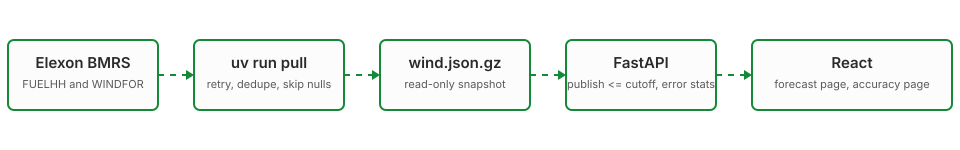

# wind desk
A buyer picks tomorrow's delivery day and the minute they will decide. The app shows the newest wind forecast that existed at that minute, then says in megawatts how wrong that forecast has been all January.


## the one rule
For delivery day D, decide on D-1 at a chosen time. Each half-hour uses the newest forecast with `publishTime <= cutoff`. Nothing later is ever read. The safety margin on the forecast page comes only from days that were fully scored before that decision (D-2 and earlier), so the demo cannot grade itself on the future.

## Stack:

- **Snapshot file, not a database.** The month is fixed and the brief asks for no storage. A read-only file is what a serverless disk allows anyway, and the demo cannot die on an Elexon 429.
- **Standard library maths, not pandas.** About a hundred thousand rows. Percentiles are ten lines and the bundle stays small.
- **URL as state.** Day, time and toggles live in the address bar. Any screen is a link.
- **Recharts, plain Tailwind v4.** Charts read the same colour variables as the page.
- **FastAPI plus uv.** Typed query params give the 422s for free, and `uv run dev`, `uv run pull`, `uv run test` are the whole toolbox.

## files

```
api/    FastAPI app (uv). src/forecasts, src/accuracy, src/elexon, src/infra
        data/ snapshot, tests/, index.py (Vercel entry), vercel.json
web/    React + Vite + Tailwind v4. src/pages, src/components, src/api
docs/   architecture, decisions, deployment, analysis, flow.svg
compose.yml  local Docker for both
```

## start

```bash
cd api && uv sync && uv run pull && uv run dev
cd web && cp .env.example .env && pnpm install && pnpm dev
```

`uv run test` runs the api tests. `docker compose up --build` runs both in Docker.

## links

- Web app: `https://reint-prediction.vercel.app`
- API: `https://reint-wind-api.vercel.app/docs`
